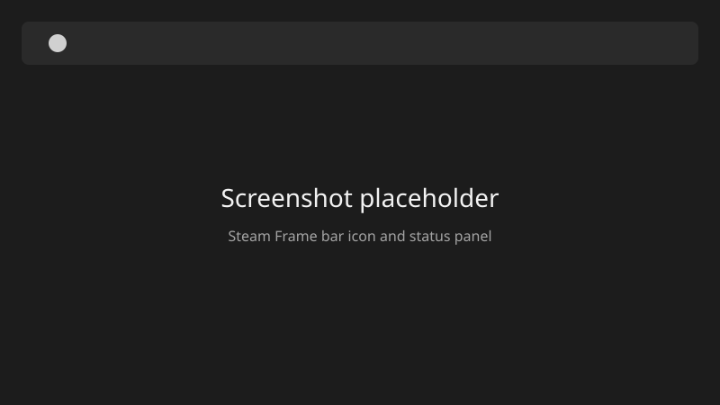

# Steam Frame

Omarchy bar widget for a Steam Frame headset. It shows whether the headset has a picture or only a radio link, the charge, the SteamVR state, and whether audio is in the game or on this computer. Open the icon to read it. A switch hides or shows the SteamVR status window.



That image is a placeholder. Replace `docs/screenshot.svg` with a capture of the bar icon and the open panel before a public release.

## What a refresh does

Refresh runs only:

- `steam-frame status`
- `steam-frame find`
- `steam-frame bridge` (no `--apply`)
- one optional read-only command from `~/.config/steam-frame/extra-status.json`, if that file exists

It does not restart Steam, gamescope, or PipeWire. It does not run `vrcmd`. It does not launch a game. It does not call `bridge --apply`. It does not open SSH, and it does not call Home Assistant.

`steam-frame` is a separate command. It is not in this repository. The verdict line on the panel is that command's first line, unchanged. This widget classifies it: text that says it is sending the picture to the Frame is "picture", text that says the radio is down is "down", and anything else is "radio". Charge has to look like `64% discharging` or `80% charging`.

Audio is "in the game" when the status command reports `audio: game` (a default sink whose name contains `vrlink-sink`). Any other sink is "on the desktop". When `desktop_name` is set, that label includes the name.

The Frame window control moves the existing Hyprland client whose class is `vrmonitor` and whose title is `SteamVR Status`. Hide sends it to workspace `special:frame-hidden`. Show puts it back on the workspace it left. Both moves use Hyprland `follow = false`, so the desk workspace stays put. The untitled SteamVR helper is left alone.

## Install

The line below is pinned to tag `v1.0.0`, the version in `manifest.json`. It downloads `scripts/install-from-tag.sh` from that tag and replaces `~/.config/omarchy/plugins/jordan.steam-frame` with the tagged tree. Running it again installs the same tree. Publish the tag before using the line. The URL works once this repository is public.

```bash
tag=v1.0.0; tmp="$(mktemp)" && curl -fsSL "https://raw.githubusercontent.com/jordanpartridge/omarchy-steam-frame/${tag}/scripts/install-from-tag.sh" -o "$tmp" && sh "$tmp" "$tag"; status=$?; rm -f "$tmp"; exit "$status"
```

From a checkout, the same copy without a tag is:

```bash
scripts/install.sh
```

Both skip `.git` and bytecode. The destination is replaced, so files left over from an older copy are removed.

A third-party plugin stays off until its id is in `~/.config/omarchy/shell.json`. After the copy:

```bash
omarchy-shell shell rescanPlugins
omarchy plugin enable jordan.steam-frame
```

## Uninstall

```bash
scripts/uninstall.sh
```

Or, without a checkout:

```bash
rm -rf "${XDG_CONFIG_HOME:-$HOME/.config}/omarchy/plugins/jordan.steam-frame"
```

Remove the `jordan.steam-frame` entry from `~/.config/omarchy/shell.json` if it is still listed. `omarchy plugin remove jordan.steam-frame` does that when the Omarchy CLI is available.

These files are not deleted:

- `~/.config/steam-frame/config.json`
- `~/.config/steam-frame/extra-status.json`
- `~/.local/state/jordan.steam-frame/window.json`

## Config

Copy the example and keep it private. `config.json` is listed in `.gitignore`, and it should not be committed.

```bash
mkdir -p "${XDG_CONFIG_HOME:-$HOME/.config}/steam-frame"
cp config.example.json "${XDG_CONFIG_HOME:-$HOME/.config}/steam-frame/config.json"
chmod 700 "${XDG_CONFIG_HOME:-$HOME/.config}/steam-frame"
chmod 600 "${XDG_CONFIG_HOME:-$HOME/.config}/steam-frame/config.json"
```

The directory and the file must be owned by you, with no group or other permissions. A missing file means empty defaults. A present but invalid file still lets refresh run, and the panel shows a config error. Error text does not include the values from the file.

| Key | What the widget does with it |
| --- | --- |
| `desktop_name` | Short label for this computer, used only in the audio line. Empty means "on the desktop". |
| `steam_frame_bin` | Absolute path of the `steam-frame` command. Empty means `~/.local/bin/steam-frame`. |
| `headset_ip` | Headset address on the dongle network. Checked, then dropped. |
| `headset_host` | SSH host name for the headset. Checked, then dropped. |
| `headset_port` | SSH port, or `null`. Checked, then dropped. |
| `headset_user` | SSH user. SteamOS uses `steamos`. Checked, then dropped. |
| `connection_name` | NetworkManager connection for the wireless adapter. Checked, then dropped. |
| `steam_dir` | Absolute path of the Steam directory. Checked, then dropped. |

The headset keys are the desk-specific settings for the separate `steam-frame` command. This widget reads them so a bad file is reported. It does not put them on a command line, in the panel text, or in the status JSON. Point `steam-frame` at the same values. This repository does not contact the headset.

### Extra status command

One extra command, with no widget edit. It must be a regular executable you own, not a symlink, and not a shell. Writes are refused (`--apply`, `restart`, `vrcmd`, `steam-frame-host`, `systemctl`, `pactl`, `wpctl`, and a shell).

```bash
/usr/bin/python3 -I -S ~/.config/omarchy/plugins/jordan.steam-frame/bin/refresh.py register -- /absolute/path/to/status-command
```

That writes `~/.config/steam-frame/extra-status.json` mode `0600`. The next refresh shows up to eight lines from the command.

Opening the panel does not create the config or state files. Hiding the window creates the state file. Register creates the extra-status file. Copying the example is what creates `config.json`.

## Development

```bash
python3 -I -m unittest discover -s tests -v
python3 -I scripts/validate_manifest.py
python3 -I scripts/scrub_check.py
```

GitHub Actions runs those, plus ruff, shellcheck, gitleaks, and trufflehog.
